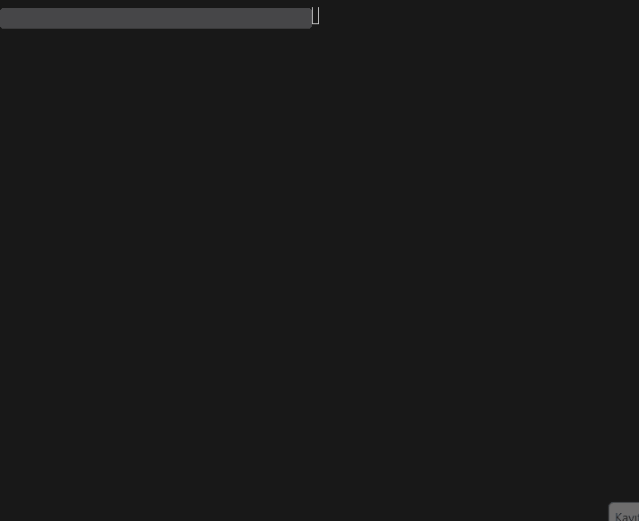

<div align="center">


# EcoTrace

### High-Precision Energy and Emissions Instrumentation
---
**v1.7.1 — Performance & Telemetry Stability Patch.** High-performance in-memory CPU database caching, defensive isolation in LangChain tracking callbacks, narrow terminal ASCII scaling fixes, and container environment safeguards.
---

**EcoTrace is a lightweight, zero-configuration hardware profiler for Python applications, AI training pipelines, and LLM workloads. Measure exact process-scoped energy consumption (Joules/kWh), runtime latency, and operational carbon footprint ($gCO_2$) without background daemons.**

Hardware-Level Telemetry (RAPL / NVML / Apple Silicon) • Process-Scoped Isolation • Native LLM & LangChain Callbacks • 100% Offline & Local-First

<br>

[](https://pypi.org/project/ecotrace/)
[](https://python.langchain.com/docs/integrations/providers/all_providers/)
[](https://www.python.org/downloads/)
[](https://pepy.tech/project/ecotrace)
[](https://opensource.org/licenses/MIT)
[](https://doi.org/10.5281/zenodo.22834060)
[](https://scorecard.dev/viewer/?uri=github.com/Zwony/ecotrace)
[](https://www.bestpractices.dev/projects/14713)
[](https://codecov.io/gh/Zwony/ecotrace)
[](https://hub.xerj.org/contributors/Zwony)
[](https://discord.gg/hs58XXb3Uq)

<br>

> [!NOTE]
> **Official LangChain Integration:** EcoTrace is officially cataloged in the [LangChain Integration Directory](https://python.langchain.com/docs/integrations/providers/all_providers/) for LLM hardware energy, latency, and emissions profiling.

> [!TIP]
> **VS Code Extension:** Monitor function-level energy and emissions in real time with CodeLens while you code. [Download here](https://marketplace.visualstudio.com/items?itemName=ecotrace-team.ecotrace-monitor).

> [!TIP]
> **Hosted Web Dashboard (Optional):** Stream metrics in real-time to our hosted team platform at [**ecotracelibrary.com**](https://ecotracelibrary.com).

<br>



*Function-level energy and carbon measurement with real-time monitoring*

</div>

---

## Core Features in v1.7.0

> **Latest Release.** v1.7.0 introduces native LangChain callback instrumentation, global carbon grid database expansion to 200+ countries, terminal ASCII table reporting, and streamlined CPU architecture resolution.

- **Native LangChain Callback (`ecotrace.callbacks.langchain`)** — Thread-safe `EcoTraceLangChainCallback` for LangChain and chat models. Measures process-scoped energy and carbon consumption per `run_id`, recording model names, execution durations, emissions ($gCO_2$), and provider token usage.
- **Global Grid Expansion (200+ Countries/Zones)** — Built-in `CARBON_INTENSITY_MAP` upgraded with verified country-level generation intensity data from the Ember Climate 2025/2026 dataset, providing offline local grid resolution across 209 countries and territories with zero configuration.
- **Terminal ASCII Analysis Table (`ecotrace analyze --table`)** — Bordered per-function breakdown table with responsive terminal width auto-scaling, column totals, and zero new third-party dependencies.
- **Unified Hardware Specification Resolution** — Direct matching against the 6,980+ CPU specification dataset for all x86 and Apple Silicon architectures, eliminating deprecated hardcoded mappings.
- **HuggingFace & CodeCarbon Drop-in Interoperability** — Full compatibility with HuggingFace `TrainerCallback` and CodeCarbon API signatures (`EmissionsTracker`, `@track_emissions`).

---

## Quick Install

```bash
pip install ecotrace
```

Optional extras:
```bash
pip install ecotrace[gpu]   # NVIDIA GPU (NVML) support
pip install ecotrace[ai]    # Gemini AI code optimization insights
pip install ecotrace[all]   # Full dependencies (GPU + AI + Report generation)
```

---

## Quick Start (100% Local & Offline)

EcoTrace works entirely on your local machine with **zero configuration, zero API keys, and no required accounts**.

### Option 1: 3-Line Function Profiler
Decorate any synchronous or asynchronous function to immediately inspect its runtime energy draw and carbon impact:

```python
from ecotrace import EcoTrace

eco = EcoTrace()

@eco.track
def process_data():
    # Your heavy compute, batch job, or inference logic
    return sum(i * i for i in range(10_000_000))

process_data()
```
*When your script exits, EcoTrace automatically prints an accurate hardware breakdown (Joules, Wh, execution latency, and $gCO_2$).*

### Option 2: Zero-Code CLI Profiler
Profile any standalone Python script or training run without changing a single line of source code:

```bash
# Run script with terminal ASCII breakdown table
ecotrace run my_script.py --table
```

### Option 3: LangChain & AI Agent Callback (LLM Profiling)
Officially listed in the [LangChain Provider Directory](https://python.langchain.com/docs/integrations/providers/all_providers/). Measure the exact hardware energy footprint and token consumption of every LLM call, RAG pipeline, or autonomous agent:

```python
from ecotrace.callbacks import EcoTraceLangChainCallback

cb = EcoTraceLangChainCallback(project_name="rag-pipeline")
llm.invoke("Summarise this document...", config={"callbacks": [cb]})

print(f"Total Emissions: {cb.total_emissions_g:.6f} gCO2")
print(cb.records)  # per-call breakdown: model, duration, token usage, emissions
```

### Option 4: A/B Implementation Comparison
Directly compare the energy efficiency and execution speed of two alternative algorithms or libraries (e.g., Pandas vs. Polars):

```python
from ecotrace import EcoTrace

eco = EcoTrace()

# Compares runtime, CPU utilization, Joules, and carbon side-by-side
eco.compare(pandas_pipeline, polars_pipeline)
```

### Option 5: Carbon Budget & Guardrail Mode
Set an operational budget and trigger alerts when your workload exceeds thresholds:

```python
eco = EcoTrace(
    region_code="TR",
    carbon_limit=5.0,  # 5 gCO2 budget
    on_budget_exceeded=lambda total, limit: print(f"Budget exceeded: {total:.4f}/{limit:.4f} gCO2")
)

@eco.track
def training_pipeline():
    ...

training_pipeline()
print(f"Remaining budget: {eco.remaining_budget} gCO2")
```

### Option 6: HuggingFace Transformers Integration
Log step-by-step training emissions directly inside HuggingFace `Trainer`:

```python
from transformers import Trainer
from ecotrace.callbacks import EcoTraceHuggingFaceCallback

trainer = Trainer(
    model=model,
    args=training_args,
    callbacks=[EcoTraceHuggingFaceCallback()],
)
trainer.train()
```

### Option 7: Drop-in CodeCarbon Compatibility
Migrate legacy codebases with zero refactoring — just change your import statement:

```python
# from codecarbon import EmissionsTracker  <-- Change to EcoTrace:
from ecotrace import EmissionsTracker

tracker = EmissionsTracker(project_name="bert-finetuning")
tracker.start()
# ... your model training or inference ...
emissions = tracker.stop()
print(f"Emissions: {emissions:.6f} kg CO2")
```

---

## Optional: Live Web Observatory & Cloud Dashboard

If you want live streaming dashboards, team collaboration, or persistent audit history across cloud clusters, connect your local runs to our hosted platform at [**ecotracelibrary.com**](https://ecotracelibrary.com):

```bash
# 1. Login with your personal ingestion key from https://ecotracelibrary.com
ecotrace login --key eco_usr_abc123...

# 2. Run your script — telemetry automatically streams to your web dashboard!
ecotrace run my_script.py
```

Or connect programmatically via Python:
```python
eco = EcoTrace(api_key="eco_usr_abc123...", region_code="US")
```

### Expected Output
When initialized, EcoTrace performs automated hardware detection:

```text
[EcoTrace] INFO: [INFO] EcoTrace instrumentation session initialized (STATIC).
[EcoTrace] INFO: -----------------------------------------------------
[EcoTrace] INFO: Region        : TR (475 gCO2/kWh)
[EcoTrace] INFO: Hardware Logic: 13th Gen Intel Core i7-13700H
[EcoTrace] INFO: Specifications: 20 Cores | 45.0W TDP
[EcoTrace] INFO: Energy Sensor : Boavizta Advanced Estimation
[EcoTrace] INFO: Memory Config : 15.6 GB DDR4
[EcoTrace] INFO: GPU Accelerator: Intel Iris Xe Graphics (15.0W TDP)
[EcoTrace] INFO: -----------------------------------------------------
```

At process exit, a session summary is printed automatically:

```text
=======================================================
  EcoTrace — Session Summary
=======================================================
  Duration       : 12.34s
  Functions      : 5 tracked
  Total Carbon   : 0.00312000 gCO2
  Region         : TR (475 gCO2/kWh)
  Budget         : 0.003120 / 5.000000 gCO2 (0.1%) [OK]
  Equivalent     : 0.4 min of LED bulb (10W)
=======================================================
```

---

## CI/CD & Testing Integration

### Official GitHub Action (Carbon Gate)
Enforce carbon emission budgets directly in your GitHub pull requests. Add this to your `.github/workflows/ci.yml`:

```yaml
- name: Run Tests with Carbon Profiling
  run: pytest --ecotrace

- name: EcoTrace Carbon Gate
  uses: Zwony/ecotrace@v1.7.0
  with:
    budget: '5.0'    # Fails pipeline if total test emissions exceed 5.0 gCO2
    region: 'US'
```

### Pytest Plugin Integration
Measure per-test function carbon footprints directly from your test suite:

```bash
pytest --ecotrace
```

### Manual CLI Gate
Run the gate locally or inside custom continuous integration pipelines:

```bash
ecotrace gate --budget 5.0 --region US
```

If total emissions recorded in `ecotrace_log.csv` exceed the budget, the command exits with code `1` — preventing carbon-heavy regressions from merging into production.

---

## Why EcoTrace?

| Feature | **EcoTrace v1.6** | CodeCarbon | CarbonTracker |
|---|:---:|:---:|:---:|
| **Sampling Interval** | **50ms** | 15s | Per Epoch |
| **Isolation** | **Process-scoped** | System-wide | System-wide |
| **Cloud Dashboard Sync** | **Native** | No | No |
| **Multi-GPU Tracking** | **Continuous (Aggregated)** | Single GPU | Per Epoch |
| **CPU Dataset** | **6,980+ CPUs** | Limited | Limited |
| **Budget Enforcement** | **Built-in** | No | No |
| **CI/CD Gate** | **Built-in** | No | No |
| **Idle Noise Subtraction** | **Automatic** | No | No |
| **Async Support** | **Native** | Limited | No |

- **Deep Transparency:** Derived from 6,980+ verified manufacturer TDP specifications rather than category averages.
- **Fail-Safe Architecture:** Guaranteed application continuity even if hardware drivers or API keys are missing.
- **Actionable AI:** Integrates with Google Gemini to provide specific code optimization advice (optional).

---

## Academic Benchmarks & Empirical Research

> [!TIP]
> **Official Technical Whitepaper:** Download the comprehensive [**EcoTrace Technical Whitepaper (PDF)**](EcoTrace_Whitepaper.pdf) or view the online [**WHITE_PAPER.md**](WHITE_PAPER.md) for complete mathematical derivations, RAPL hardware validation metrics ($MAPE \le 6.8\%$), and empirical study analyses.

EcoTrace includes a reproducible [**Academic Benchmark Suite**](benchmarks/) designed for peer-reviewed green computing research. Every article in `benchmarks/articles/` is **auto-generated** from real measurement JSONs in `benchmarks/results/` by `benchmarks/report_generator.py` — re-run the generator after new measurements to keep the published numbers in sync.

- **Data Engineering:** [Pandas vs. Polars on 5M Rows](benchmarks/articles/01_pandas_vs_polars.md) — 83.8% carbon reduction via Arrow vectorization (real numbers from this machine).
- **Computer Science:** [Algorithmic Complexity Carbon Scaling](benchmarks/articles/03_sorting_algorithms.md) — Insertion Sort at $N = 50{,}000$ emits **~3,469× more carbon** than NumPy on the same input (the *quadratic carbon cliff*).
- **Cloud Architecture:** [Web Framework Throughput vs. Carbon](benchmarks/articles/04_web_frameworks.md) — Flask vs. FastAPI under identical load; FastAPI achieves 1.13× speedup and 9.8% carbon reduction (CPU mode).
- **Generative AI:** [LLM Inference Carbon Footprint](benchmarks/articles/05_llm_inference.md) — Per-token energy and carbon cost of GPT-2 inference (CPU mode; medium/large models require GPU).
- **Cloud Architecture:** [Spatial Carbon Arbitrage across 15 Countries](benchmarks/articles/06_regional_carbon.md) — The same workload in South Africa emits **~73× more carbon** than in Sweden (a 99% reduction is achievable by region selection alone).
- **Metrology Validation:** [Empirical Accuracy vs. Intel RAPL Counters](benchmarks/articles/07_accuracy_validation.md) — model-vs-hardware validation methodology with honest synthetic-mode fallback for non-Linux systems.
- **Machine Learning:** [PyTorch vs. TensorFlow CNN Training](benchmarks/articles/02_ml_training_frameworks.md) — Carbon per accuracy point analysis (CPU mode; numbers regenerate after each run).

### Citing EcoTrace

If you use EcoTrace or its benchmark suite in scientific publications:

```bibtex
@software{ozkal2026ecotrace,
  author = {Ozkal, Emre},
  title = {EcoTrace: High-Precision Energy and Emissions Instrumentation for Python},
  year = {2026},
  url = {https://github.com/Zwony/ecotrace},
  version = {1.6.0}
}
```

---

## Documentation

Full documentation is available at [**ecotracelibrary.com**](https://ecotracelibrary.com) and [**ecotrace.readthedocs.io**](https://ecotrace.readthedocs.io/en/latest/).

- [**Official Website**](https://ecotracelibrary.com) — Live carbon dashboard and web management platform.
- [**Architecture and Science**](https://ecotrace.readthedocs.io/en/latest/ARCHITECTURE/) — How the energy model and process isolation work.
- [**Advanced Usage**](https://ecotrace.readthedocs.io/en/latest/USAGE/) — GPU tracking, AI insights, benchmarks, and comparison tables.
- [**API Reference**](https://ecotrace.readthedocs.io/en/latest/api/) — Technical documentation for core classes and functions.
- [**Support and Reference**](https://ecotrace.readthedocs.io/en/latest/SUPPORT/) — Troubleshooting, region codes, and hardware compatibility.
- [**Technical Whitepaper (PDF)**](EcoTrace_Whitepaper.pdf) — Comprehensive metrology and empirical evaluation report.

---

## Citation

If you use EcoTrace in academic research or sustainability audits, please cite:

```bibtex
@software{ecotrace2026,
  author = {Ozkal, Emre},
  title = {EcoTrace: High-Precision Energy and Emissions Instrumentation for Python},
  year = {2026},
  publisher = {Zenodo},
  version = {v1.7.1},
  doi = {10.5281/zenodo.22834060},
  url = {https://doi.org/10.5281/zenodo.22834060}
}
```

---

## Contributing

We welcome contributions! Please see our [**CONTRIBUTING.MD**](CONTRIBUTING.MD) for guidelines on reporting bugs, suggesting features, or contributing hardware data.

---

## Community

[](https://discord.gg/hs58XXb3Uq)

[CHANGELOG.md](CHANGELOG.md) · [SECURITY.MD](SECURITY.MD)

---

## Author and License

**Emre Ozkal** — [GitHub](https://github.com/Zwony) · [ecotraceteam@gmail.com](mailto:ecotraceteam@gmail.com)

MIT License — Use it however you like.

<div align="center">

*Developed for sustainable software development practices.*

</div>
