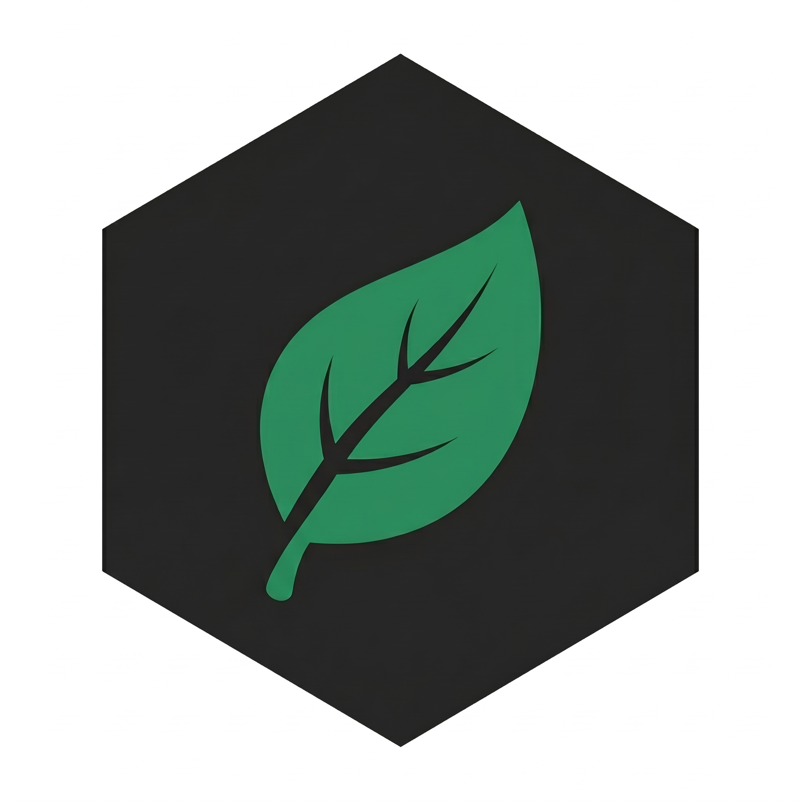

<div align="center" markdown="1">



# EcoTrace

### High-Precision Energy and Emissions Instrumentation
---
**v1.7.1 — Performance & Telemetry Stability Patch.** High-performance in-memory CPU database caching, defensive isolation in LangChain tracking callbacks, narrow terminal ASCII scaling fixes, and container environment safeguards.
---

**EcoTrace is a lightweight, zero-configuration hardware profiler for Python applications, AI training pipelines, and LLM workloads. Measure exact process-scoped energy consumption (Joules/kWh), runtime latency, and operational carbon footprint ($gCO_2$) without background daemons.**

Hardware-Level Telemetry (RAPL / NVML / Apple Silicon) • Process-Scoped Isolation • Native LLM & LangChain Callbacks • 100% Offline & Local-First

<br>

[](https://pypi.org/project/ecotrace/)
[](https://python.langchain.com/docs/integrations/providers/all_providers/)
[](https://www.python.org/downloads/)
[](https://pepy.tech/project/ecotrace)
[](https://opensource.org/licenses/MIT)
[](https://doi.org/10.5281/zenodo.22834060)
[](https://scorecard.dev/viewer/?uri=github.com/Zwony/ecotrace)
[](https://www.bestpractices.dev/projects/14713)
[](https://codecov.io/gh/Zwony/ecotrace)
[](https://discord.gg/hs58XXb3Uq)

<br>

> [!NOTE]
> **Official LangChain Integration:** EcoTrace is officially cataloged in the [LangChain Integration Directory](https://python.langchain.com/docs/integrations/providers/all_providers/) for LLM hardware energy, latency, and emissions profiling. Check out our dedicated [LangChain Integration Guide](integrations/langchain.md).

> [!TIP]
> **VS Code Extension:** Monitor function-level energy and emissions in real time with CodeLens while you code. [Download here](https://marketplace.visualstudio.com/items?itemName=ecotrace-team.ecotrace-monitor).

> [!TIP]
> **Hosted Web Dashboard (Optional):** Stream metrics in real-time to our hosted team platform at [**ecotracelibrary.com**](https://ecotracelibrary.com).

<br>


*Function-level energy and carbon measurement with real-time monitoring*

</div>

---

## Core Features in v1.7.0

> **Latest Release.** v1.7.0 introduces native LangChain callback instrumentation, global carbon grid database expansion to 200+ countries, terminal ASCII table reporting, and streamlined CPU architecture resolution.

- **Native LangChain Callback (`ecotrace.callbacks.langchain`)** — Thread-safe `EcoTraceLangChainCallback` for LangChain and chat models. Measures process-scoped energy and carbon consumption per `run_id`, recording model names, execution durations, emissions ($gCO_2$), and provider token usage.
- **Global Grid Expansion (200+ Countries/Zones)** — Built-in `CARBON_INTENSITY_MAP` upgraded with verified country-level generation intensity data from the Ember Climate 2025/2026 dataset, providing offline local grid resolution across 209 countries and territories with zero configuration.
- **Terminal ASCII Analysis Table (`ecotrace analyze --table`)** — Bordered per-function breakdown table with responsive terminal width auto-scaling, column totals, and zero new third-party dependencies.
- **Unified Hardware Specification Resolution** — Direct matching against the 6,980+ CPU specification dataset for all x86 and Apple Silicon architectures, eliminating deprecated hardcoded mappings.
- **HuggingFace & CodeCarbon Drop-in Interoperability** — Full compatibility with HuggingFace `TrainerCallback` and CodeCarbon API signatures (`EmissionsTracker`, `@track_emissions`).

---

## Quick Install

```bash
pip install ecotrace
```

Optional extras:
```bash
pip install ecotrace[gpu]   # NVIDIA GPU (NVML) support
pip install ecotrace[ai]    # Gemini AI code optimization insights
pip install ecotrace[all]   # Full dependencies (GPU + AI + Report generation)
```

---

## Quick Start (100% Local & Offline)

EcoTrace works entirely on your local machine with **zero configuration, zero API keys, and no required accounts**.

### Option 1: 3-Line Function Profiler
Decorate any synchronous or asynchronous function to immediately inspect its runtime energy draw and carbon impact:

```python
from ecotrace import EcoTrace

eco = EcoTrace()

@eco.track
def process_data():
    # Your heavy compute, batch job, or inference logic
    return sum(i * i for i in range(10_000_000))

process_data()
```
*When your script exits, EcoTrace automatically prints an accurate hardware breakdown (Joules, Wh, execution latency, and $gCO_2$).*

### Option 2: Zero-Code CLI Profiler
Profile any standalone Python script or training run without changing a single line of source code:

```bash
# Run script with terminal ASCII breakdown table
ecotrace run my_script.py --table
```

### Option 3: LangChain & AI Agent Callback (LLM Profiling)
Officially listed in the [LangChain Provider Directory](https://python.langchain.com/docs/integrations/providers/all_providers/). For complete guide, see [LangChain Integration Documentation](integrations/langchain.md).

```python
from ecotrace.callbacks import EcoTraceLangChainCallback

cb = EcoTraceLangChainCallback(project_name="rag-pipeline")
llm.invoke("Summarise this document...", config={"callbacks": [cb]})

print(f"Total Emissions: {cb.total_emissions_g:.6f} gCO2")
print(cb.records)  # per-call breakdown: model, duration, token usage, emissions
```

### Option 4: A/B Implementation Comparison
Directly compare the energy efficiency and execution speed of two alternative algorithms or libraries (e.g., Pandas vs. Polars):

```python
from ecotrace import EcoTrace

eco = EcoTrace()

# Compares runtime, CPU utilization, Joules, and carbon side-by-side
eco.compare(pandas_pipeline, polars_pipeline)
```

### Option 5: Carbon Budget & Guardrail Mode
Set an operational budget and trigger alerts when your workload exceeds thresholds:

```python
eco = EcoTrace(
    region_code="TR",
    carbon_limit=5.0,  # 5 gCO2 budget
    on_budget_exceeded=lambda total, limit: print(f"Budget exceeded: {total:.4f}/{limit:.4f} gCO2")
)

@eco.track
def training_pipeline():
    ...

training_pipeline()
print(f"Remaining budget: {eco.remaining_budget} gCO2")
```

---

## Hardware Telemetry Resolution

At initialization, EcoTrace queries native hardware counters without elevated root/admin requirements whenever possible:

```text
[EcoTrace] INFO: EcoTrace instrumentation session initialized (STATIC).
[EcoTrace] INFO: -----------------------------------------------------
[EcoTrace] INFO: Region        : TR (475 gCO2/kWh)
[EcoTrace] INFO: Hardware Logic: 13th Gen Intel Core i7-13700H
[EcoTrace] INFO: Specifications: 20 Cores | 45.0W TDP
[EcoTrace] INFO: Energy Sensor : Boavizta Advanced Estimation / RAPL
[EcoTrace] INFO: Memory Config : 16.0 GB DDR4
[EcoTrace] INFO: GPU Accelerator: NVIDIA GeForce RTX 4070 (115.0W TDP)
[EcoTrace] INFO: -----------------------------------------------------
```

---

## Hosted Web Dashboard (Optional)

If you manage a development team or want persistent cloud analytics across multiple machines, you can optionally stream telemetry to [**ecotracelibrary.com**](https://ecotracelibrary.com):

```bash
# Authenticate your terminal
ecotrace login --key eco_usr_your_api_key

# Runs now stream automatically to your cloud dashboard
ecotrace run my_script.py
```
